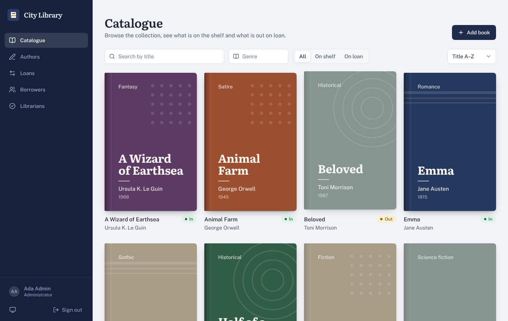
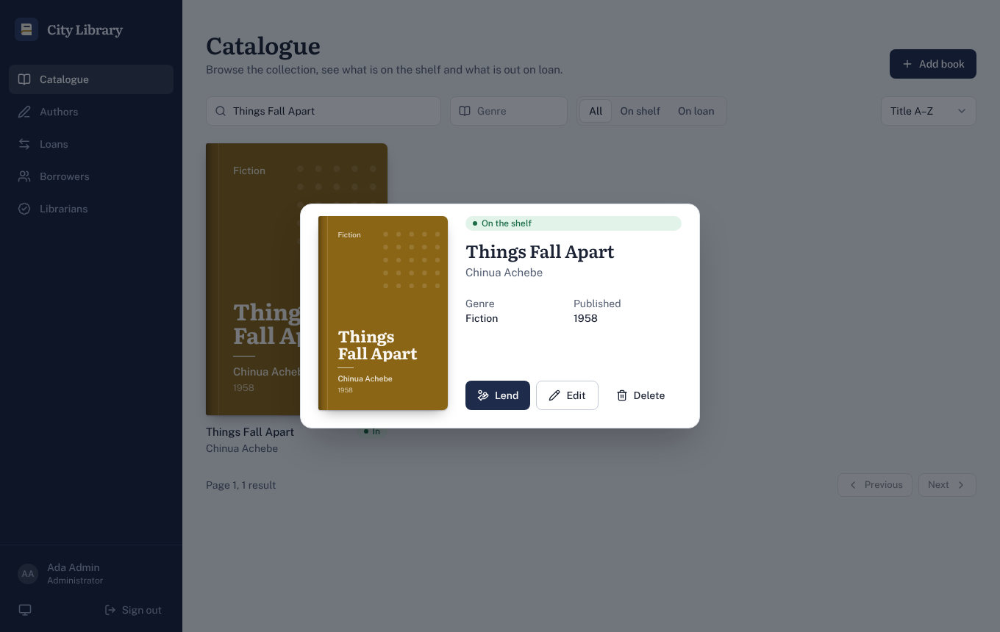
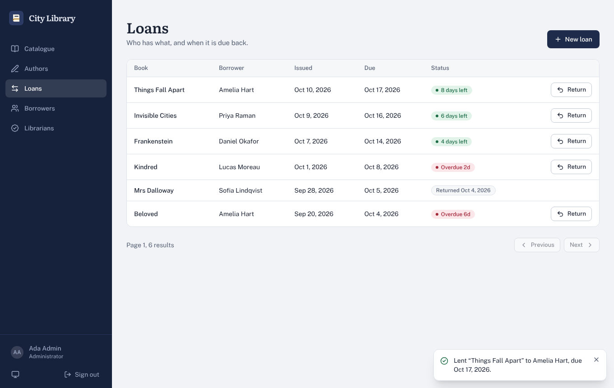
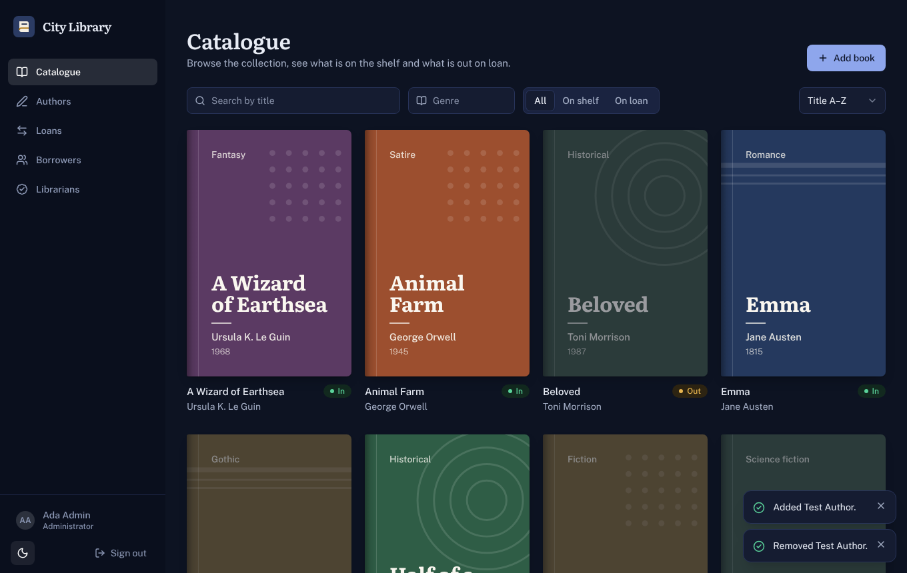
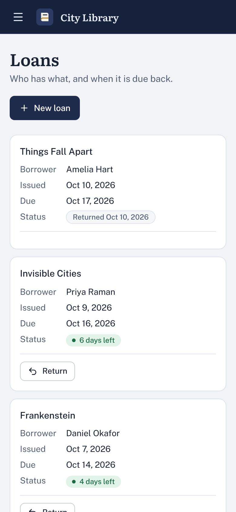

# City Library: frontend

A production-style React client for the JWT-secured library-management API. Staff lend and return books, manage the catalogue, authors, borrowers and librarians; members browse the shelves. Light, dark and system themes, fully responsive, keyboard and screen-reader friendly.



| Book detail | Loans | Dark mode | Mobile |
|---|---|---|---|
|  |  |  |  |

## Stack

React 19 · TypeScript (strict) · Vite · Tailwind CSS v4 · TanStack Query · React Router · react-hook-form + zod · Vitest + Testing Library · lucide-react

## Quick start

```bash
# 1. run the backend (see its README) on http://localhost:5000
# 2. frontend
cp .env.example .env
npm install
npm run dev          # http://localhost:5173
```

The dev server proxies `/api` to the backend, so browser and API are same-origin and the `SameSite=Strict` refresh cookie just works. Make sure `CORS_ORIGINS` on the backend includes `http://localhost:5173`.

Optional demo data (authors, books, members, loans, one overdue):

```bash
ADMIN_EMAIL=you@example.com ADMIN_PASSWORD='...' npm run seed
```

Create the first admin with the backend's `npm run create-admin`.

| Script | What it does |
|---|---|
| `npm run dev` | dev server with API proxy |
| `npm run build` | typecheck + production build |
| `npm test` | unit tests (API client, helpers) |
| `npm run seed` | demo data over the public API |

## Roles

| | Borrower | Librarian | Admin |
|---|---|---|---|
| Browse catalogue, authors | ✓ | ✓ | ✓ |
| Add/edit/delete books and authors, lend/return | | ✓ | ✓ |
| Manage borrowers | | ✓ | ✓ |
| Manage librarians | | | ✓ |

Routes are guarded in the UI, and the API enforces the same rules server-side.

## How auth works

- The **access token** (15 min) lives only in memory, never in `localStorage`, so XSS can't read it at rest.
- The **refresh token** is an `httpOnly` cookie the browser manages; the app never sees it.
- On a `401`, all failing requests share **one** refresh (single flight) and then retry once.
- The backend rotates refresh tokens on every use, so refreshes are serialised across tabs with the **Web Locks API**; two tabs can't invalidate each other.
- A refresh that fails for any reason other than "cookie rejected" (rate limit, outage, offline) does **not** sign the user out.
- Reloading restores the session from the cookie. Signing out in one tab signs out the others (`BroadcastChannel`).

## Design decisions

- **No totals from the API**, so pagination is look-ahead: it quietly fetches page + 1 to know whether "Next" is enabled (and it's cached, so clicking is instant).
- **Generated book covers**: the API has no images, so covers are deterministic typographic designs (hash of genre and title → cloth colour + motif), sized with container-query units.
- **Native `<dialog>`** for modals (focus trap, Escape, inert background from the browser) and a popover-based toast layer that sits above open dialogs.
- **Responsive tables**: a real `<table>` from `md` up, labelled cards on phones. No sideways scrolling.
- **State in the URL**: search, filters, sort and page are query params, so views are linkable and survive reload.
- Light/dark/system theme with a no-flash inline script, reduced-motion respected, skip link, lazy-loaded routes, error boundary.

## Backend notes

`backend-patch/include-names.patch` is an optional, two-file change to the backend repositories that embeds author names (books) and book/borrower/librarian names (loans) in list responses. The app works without it by looking names up individually (and shows short ids for borrowers), but with it the lists need far fewer requests.

```bash
cd library-management-system && git apply ../frontend/backend-patch/include-names.patch
```

Known API limits the UI is built around: books are paginated to at most page 20 × 8 = 160 reachable via paging (use search/filters beyond that); authors are capped at 5 per page.

## Deploying

Serve `dist/` from the **same site** as the API (e.g. behind one reverse proxy routing `/api`) to keep `SameSite=Strict` cookies. For separate sites, set `VITE_API_URL`, add the origin to the backend's `CORS_ORIGINS`, and use `COOKIE_SAMESITE=none` over HTTPS.

## Resume bullets

- Built a React 19 + TypeScript + Tailwind v4 client for a JWT-secured library API with role-based UI (borrower/librarian/admin), lazy-loaded routes and light/dark theming.
- Implemented a secure auth flow: in-memory access tokens, httpOnly rotating refresh cookies, single-flight refresh with cross-tab Web Locks, and cross-tab sign-out via BroadcastChannel.
- Designed accessible UI primitives from scratch (native-dialog modals, ARIA async combobox, responsive table-to-card layout, toast layer) with keyboard and screen-reader support.
- Worked around an API with no pagination totals using cached look-ahead pagination; kept filters, sort and page in the URL.
- Verified end to end against the real backend with Playwright (28 checks: auth, reload restore, lending/returning with undo, role gating, multi-tab refresh, mobile layout) plus Vitest unit tests.
